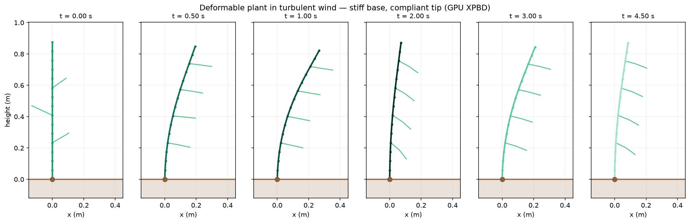

# GPU-Accelerated Plant Biomechanics Simulation for Agricultural Robots

A GPU physics solver that models crop plants as **deformable structures** —
stems that bend, leaves that flutter, and a restoring stiffness that varies
along the plant — so agricultural robots can be trained and tested against
plants that behave like plants.

Built with [NVIDIA Warp](https://github.com/NVIDIA/warp), with a drop-in
integration for **NVIDIA Isaac Sim** (verified on 6.0.1).



---

## Why

Gazebo, CoppeliaSim and Isaac Sim's PhysX pipeline treat a plant as a rigid
obstacle. That's fine for a wall and wrong for a canola stem, and it breaks
two things a robot depends on:

- **Perception** — a rigid plant always looks the same; a real one moves in
  the wind, so its silhouette from the robot's camera changes.
- **Manipulation** — a rigid simulator can say the gripper *collided*. It
  can't say whether the approach would have **snapped the stem**, because a
  rigid plant has no notion of how hard it pushes back.

## Quick start

```bash
pip install -r src/requirements.txt
```

```bash
python3 src/scripts/00_check_env.py
```

Then `01_single_stem.py`, `02_canopy.py`, `03_benchmark.py`,
`04_robot_interaction.py`. None of them need Isaac Sim.

Isaac Sim, one command — the launcher finds it and fixes the environment:

```bash
./run_isaac.sh --arm --plants 32 --seconds 10
```

Dropping the canopy into your own Isaac scene is three lines:

```python
bridge = PlantCanopyBridge(SimConfig(), n_plants=64)
bridge.build()
bridge.attach(world)
```

Tests: `python3 -m pytest src/tests -v` (24 tests).

## Three things worth knowing

**Rigidity comes from geometry, not a tuning knob.** Flexural rigidity is
`EI` with `I = πr⁴/4`. The stem tapers 5 mm → 2 mm, so the base is ~39×
stiffer by geometry alone. "Stiffness inversely proportional to height" is a
*consequence* of modelling the taper, not a rule imposed on top.

**Wind is a drag force, not an acceleration.** `F = ½ρC_dA|u−v|(u−v)` depends
on air velocity *relative to the moving plant*, so it self-limits as the plant
yields. A constant wind acceleration has no such feedback and drives a stem
flat no matter how you tune the damping.

**The solver parallelises over plants, not constraints.** A stem is a chain
and bending corrections travel one hinge per pass, which left a 17-node stem
measurably **7× too compliant** under colour-parallel solving. One thread per
plant sweeping its chain sequentially solves it almost directly.

## Validation

| Check | Result |
|---|---|
| Mesh refinement vs `qL⁴/(8EI)` | +25% → +12% → +8.4% at 9/17/33 nodes, monotone |
| Warp kernels vs independent NumPy solver | agree to ~5×10⁻⁵ m over 300 frames |
| Stem inextensibility under load | 0.0024% stretch |
| Solver convergence | substepping converges a chain ~4× cheaper than iterating |

See [`Documentation/VALIDATION.md`](Documentation/VALIDATION.md), including an
explicit *what is not validated* section.

## Status

- **No GPU timings yet.** The solver is GPU-resident with CUDA graph capture,
  but the driver on the development machine is blocked by an unenrolled
  Secure Boot MOK key, so every number here is from the CPU backend.
- **No real plant measurements yet.** All validation is against analytic beam
  theory and a second independent implementation.
- **Speed-vs-damage is a documented negative result** — peak impact
  quantities don't converge without strain-rate damping. See
  [`Documentation/SPEED_DAMAGE_FINDING.md`](Documentation/SPEED_DAMAGE_FINDING.md).

## Documentation

| Document | Contents |
|---|---|
| [README](Documentation/README.md) | full project guide |
| [ARCHITECTURE](Documentation/ARCHITECTURE.md) | the model, the maths, GPU design decisions |
| [VALIDATION](Documentation/VALIDATION.md) | how the solver is verified, and against what |
| [ISAAC_SIM](Documentation/ISAAC_SIM.md) | integration and version compatibility |
| [PARAMETERS](Documentation/PARAMETERS.md) | authoritative parameter table, generated from code |
| [SPEED_DAMAGE_FINDING](Documentation/SPEED_DAMAGE_FINDING.md) | the negative result, written up |
